# GoldenTime · del dato sucio a la decisión

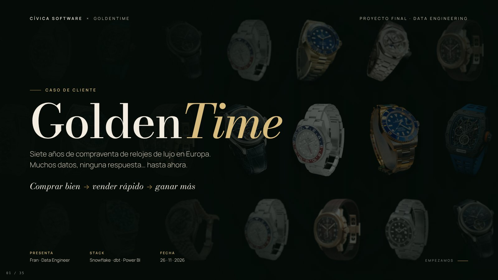

**Proyecto final · Data Engineering · Cívica Software, 2026**

GoldenTime es un grupo europeo, ficticio, que compra y vende relojes de lujo de segunda mano. Tiene 12 tiendas, un canal online y siete años de datos sin explotar. Este proyecto convierte esos datos en respuestas de negocio.

> **Comprar bien → vender rápido → ganar más**

---

## Las preguntas

| | Caso de uso | Pregunta |
|---|---|---|
| 1 | Margen real | ¿Cuánto ganamos de verdad? |
| 2 | Rotación | ¿Vendemos rápido? |
| 3 | Mercado | ¿Pagamos de más? |

## Los datos

| Fuente | Tipo | Filas |
|---|---|---|
| ERP de GoldenTime · 5 tablas | Ficticio | 919.057 |
| Chrono24 · anuncios de relojes | Real | 284.491 |
| BCE · tipos de cambio | Real | 7.092 |

## La arquitectura

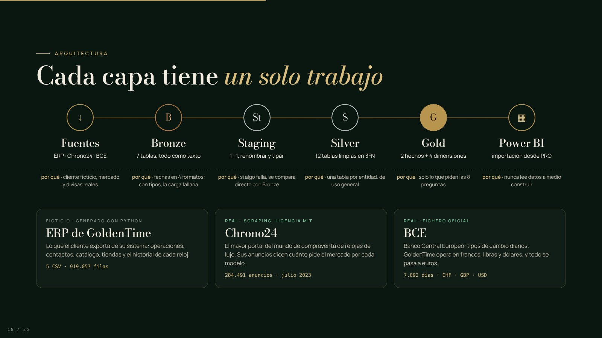

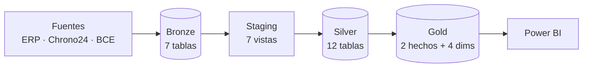

## El modelado

**Silver**: cada tabla ancha del ERP, separada en sus entidades.

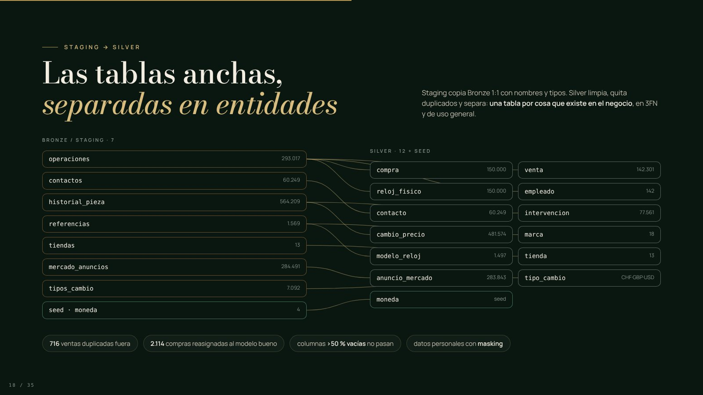

**Gold**: esquema en estrella.

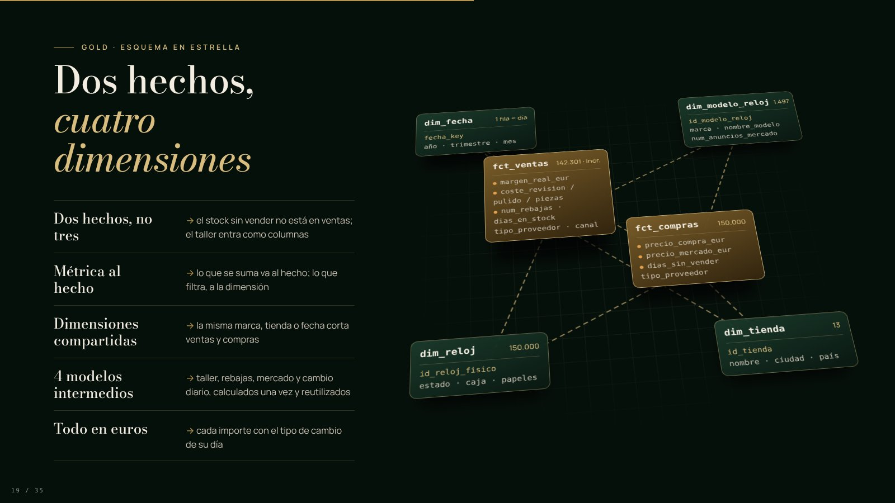

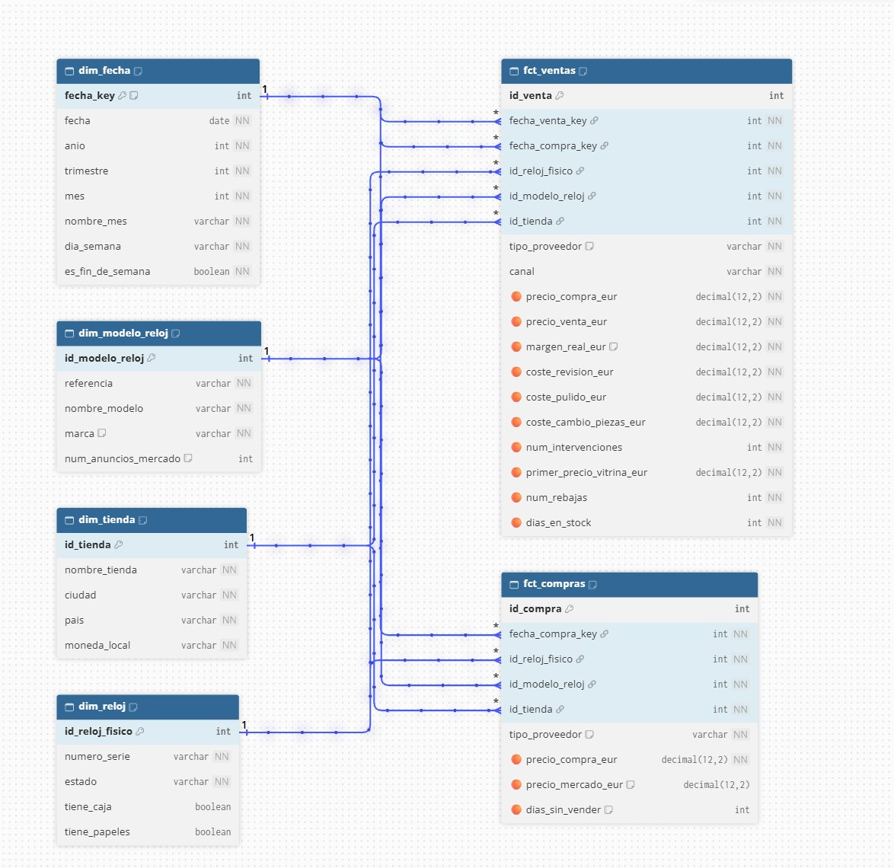

## dbt

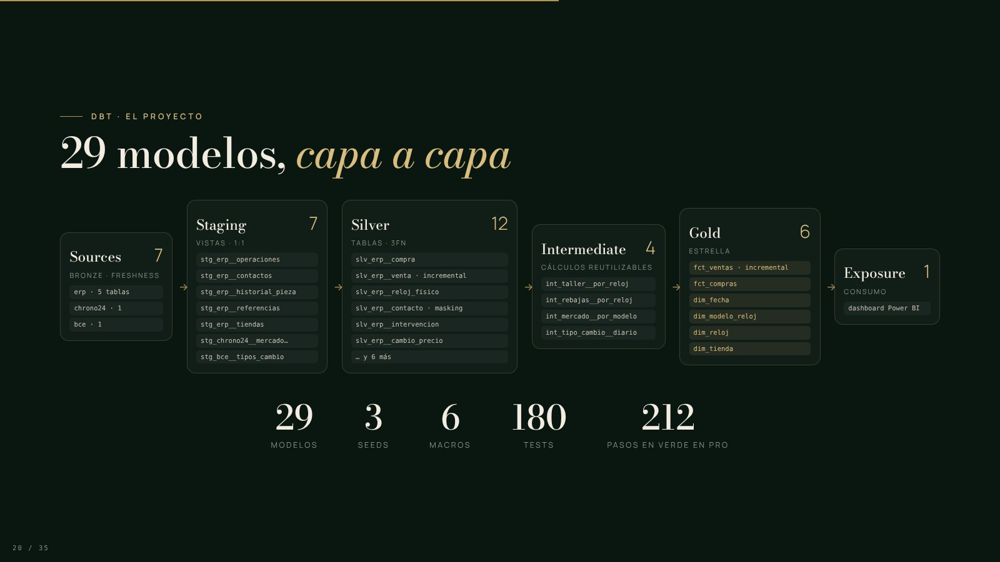

| 29 modelos | 3 seeds | 6 macros | 180 tests | 1 incremental en cadena |
|:---:|:---:|:---:|:---:|:---:|

## Las respuestas

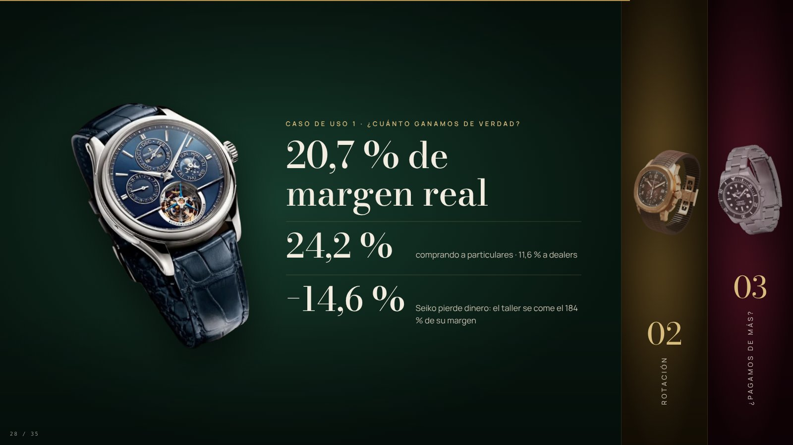

| Caso de uso | Respuesta |
|---|---|
| **Margen real** | 20,7 % de margen. Seiko pierde dinero (−14,6 %) por el taller. |
| **Rotación** | El estado manda: de 67 a 146 días. 12,1 M€ parados más de 180 días. |
| **Mercado** | Compramos un 24 % por debajo de Chrono24, sobre todo a particulares. |

## El dashboard

| | |
|---|---|
| 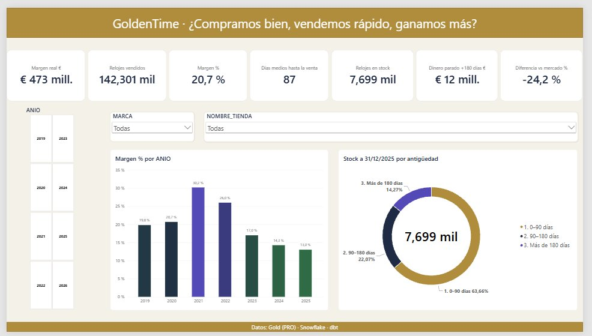 | 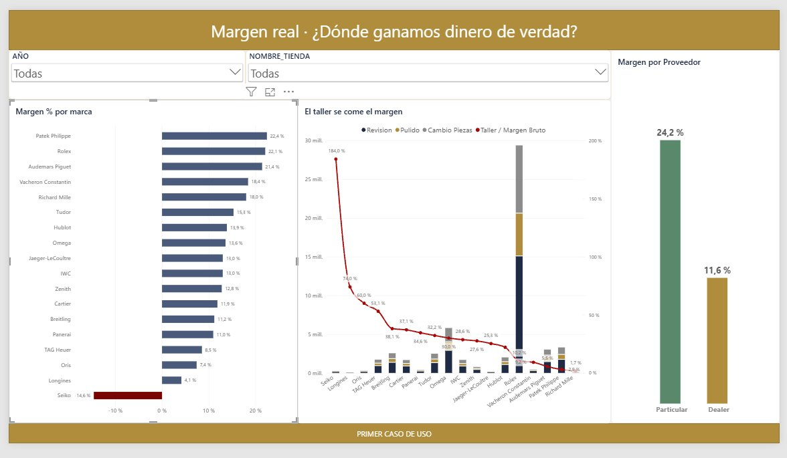 |
| 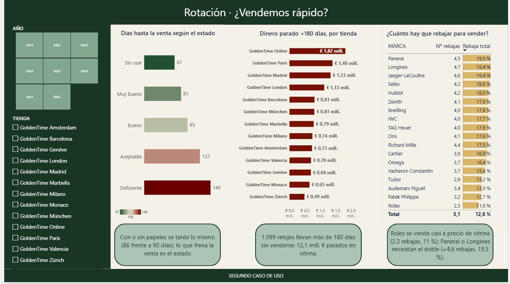 | 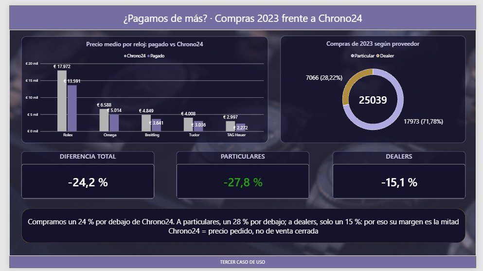 |

## La presentación

[GoldenTime_Presentacion.html](documentacion/presentacion/GoldenTime_Presentacion.html): descárgala y ábrela en el navegador. Funciona sin internet.

---

**Fran** · Data Engineer · Cívica Software
